:::writing{variant="document" id="62841"}
# Air Cargo Operations & Statistical Analytics

## Project Overview
An interactive data analytics project developed using Python, SQL, and Streamlit to analyze air cargo operations and generate meaningful insights.

## Technologies Used
- Python
- SQL / MySQL
- Pandas
- NumPy
- SciPy
- Plotly
- Streamlit

## Key Features
- Data Cleaning and Preprocessing
- Monthly and Yearly Trend Analysis
- Seasonal Trend Analysis
- Descriptive Statistical Analysis
- Correlation Analysis
- Regression Analysis
- Hypothesis Testing
- Interactive Data Visualizations
- Custom Dataset Upload and Analysis

## Dashboard Screenshots

### 1. Dashboard Overview
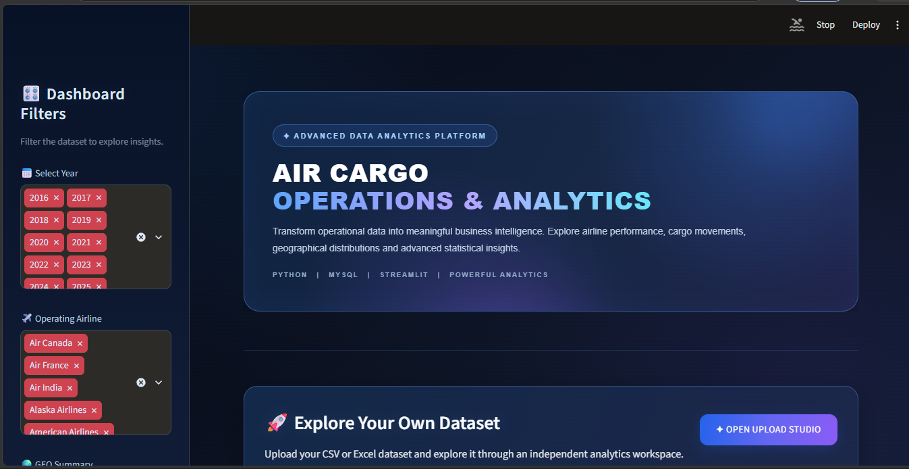

### 2. KPI Cards
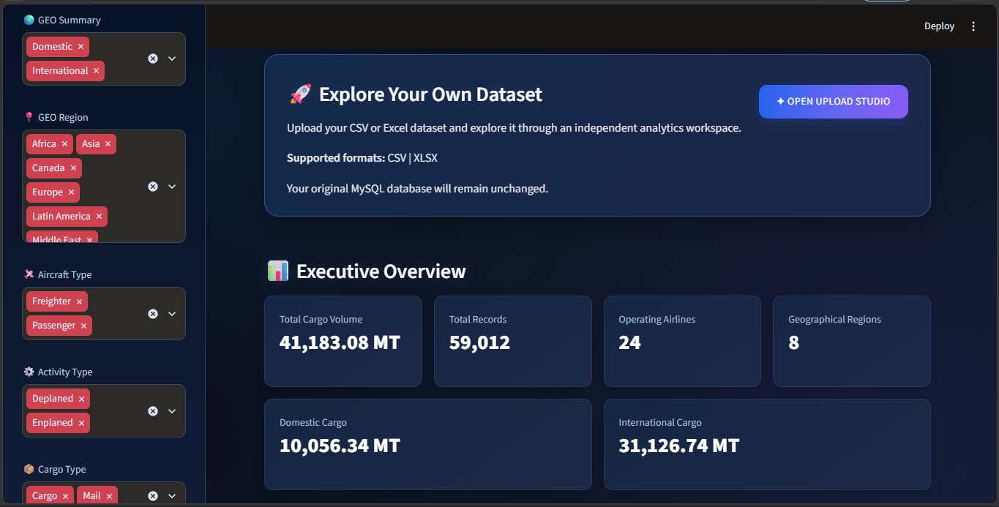

### 3. Cargo Trends
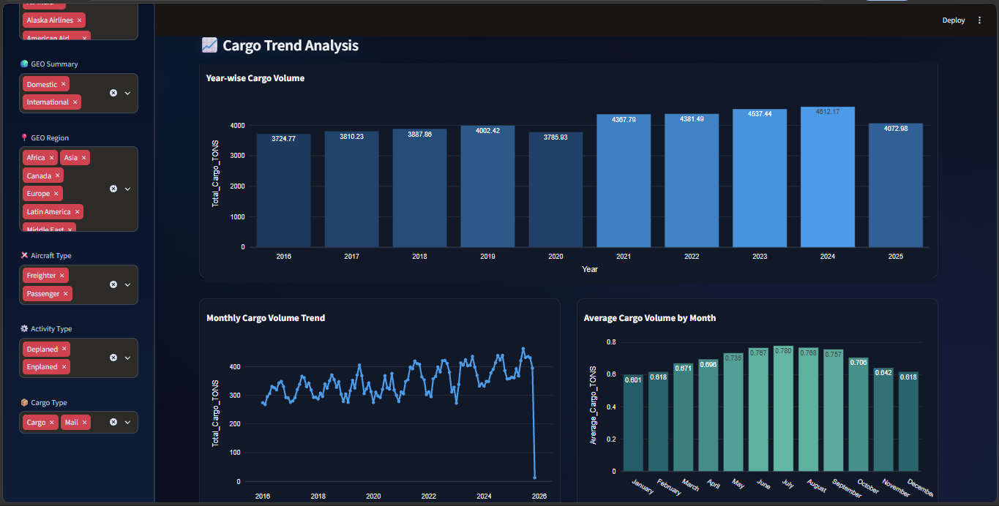

### 4. International vs Domestic Analysis
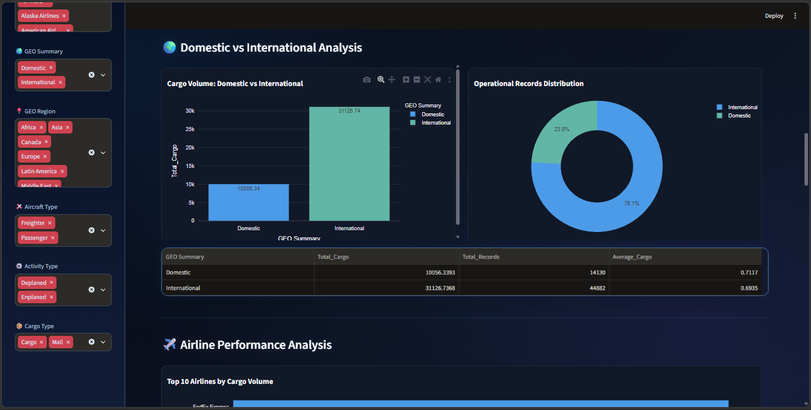

### 5. Airline Performance
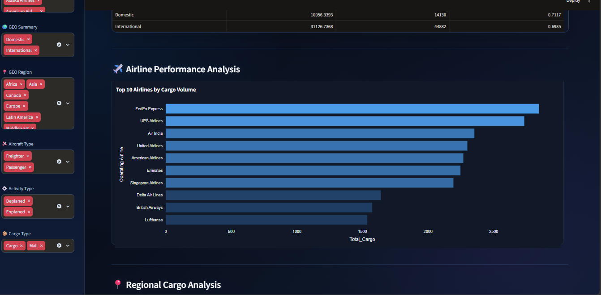

### 6. Correlation Analysis
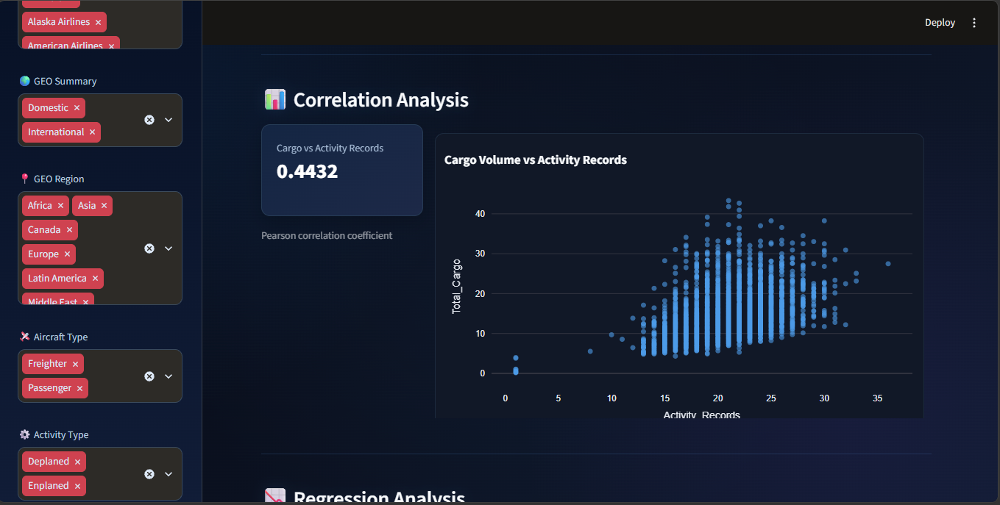

### 7. Regression Analysis
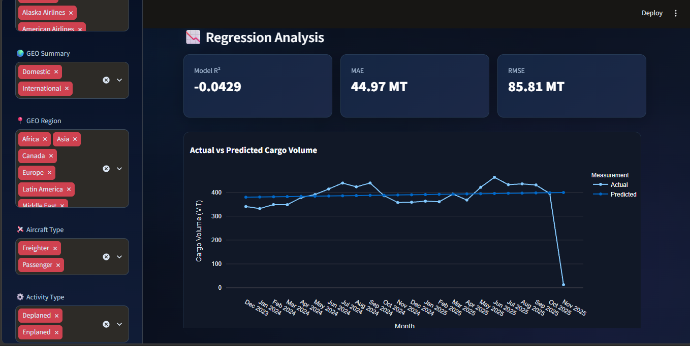

### 8. Hypothesis Testing
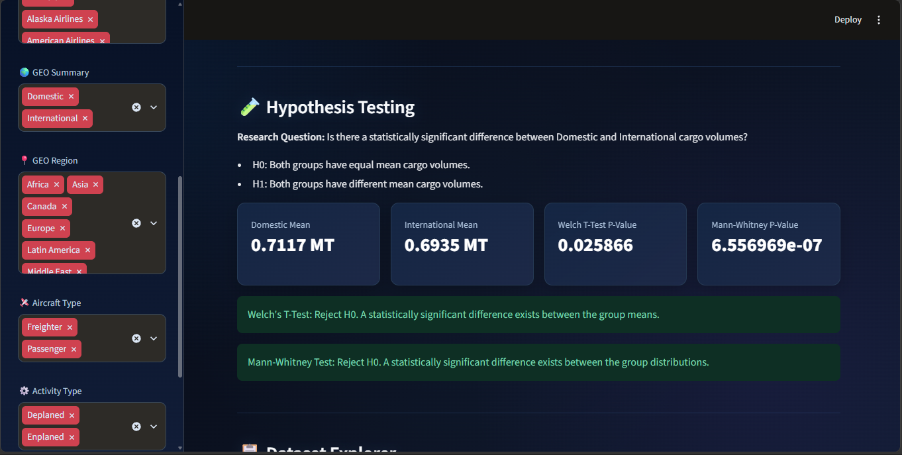

### 9. Dataset Overview
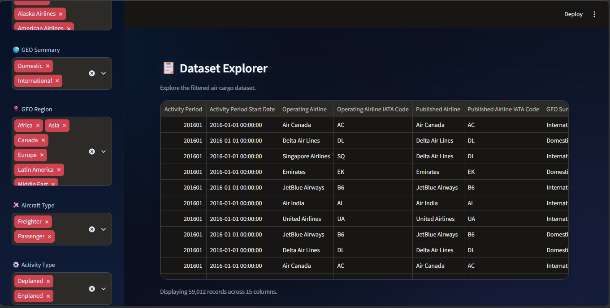

### 10. Updated Dataset Overview
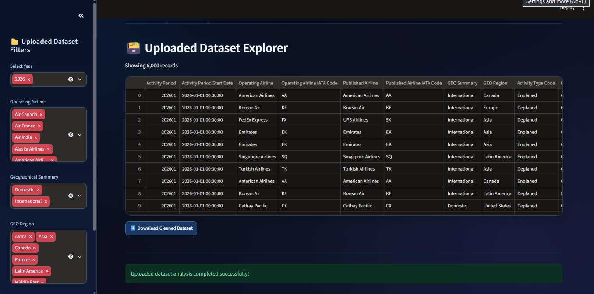

### 11. Cargo Trends Analysis
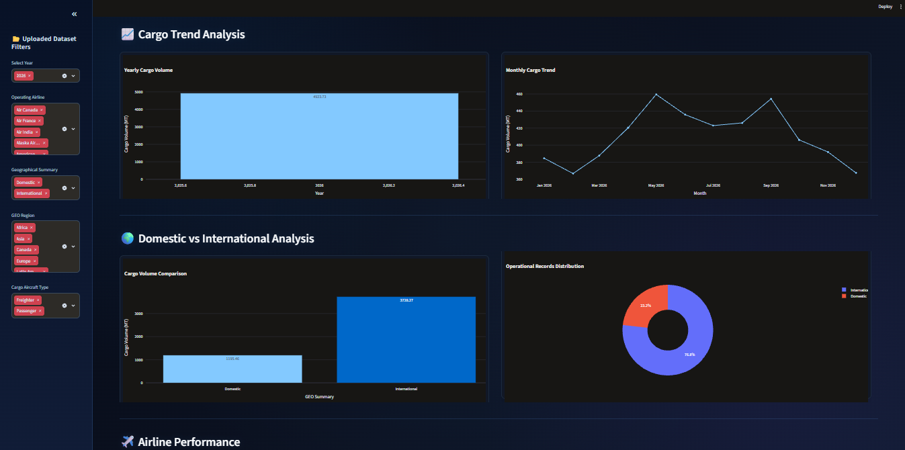

### 12. Airline & Regional Analysis
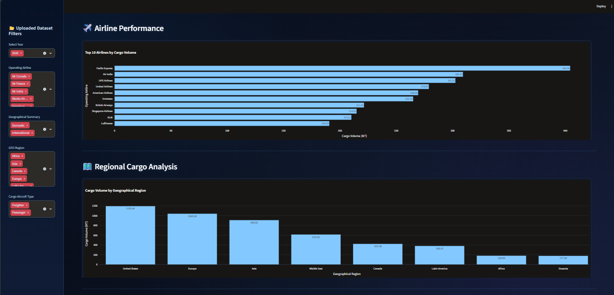

### 13. Statistical Analysis
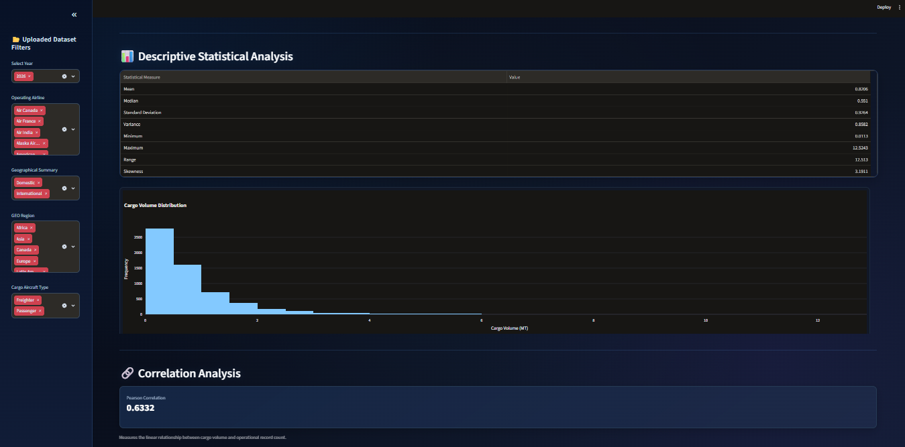

## Statistical Methods
- Pearson Correlation
- Spearman Correlation
- Linear Regression
- Welch's T-Test
- Mann–Whitney U Test

## Project Structure
- `analysis/` – Data analysis modules
- `database/` – MySQL connection
- `assets/` – Dashboard CSS design
- `visualizations/` – Charts
- `app.py` – Main Streamlit application

## How to Run

1. Clone this repository.
2. Install dependencies:

   `pip install -r requirements.txt`

3. Configure your MySQL credentials in a local `.env` file.
4. Run the application:

   `streamlit run app.py`

## Author
**S.K. Keerthi**

GitHub: https://github.com/skkeerthi502-sudo

LinkedIn: https://linkedin.com/in/keerthi-sk-846660382
:::